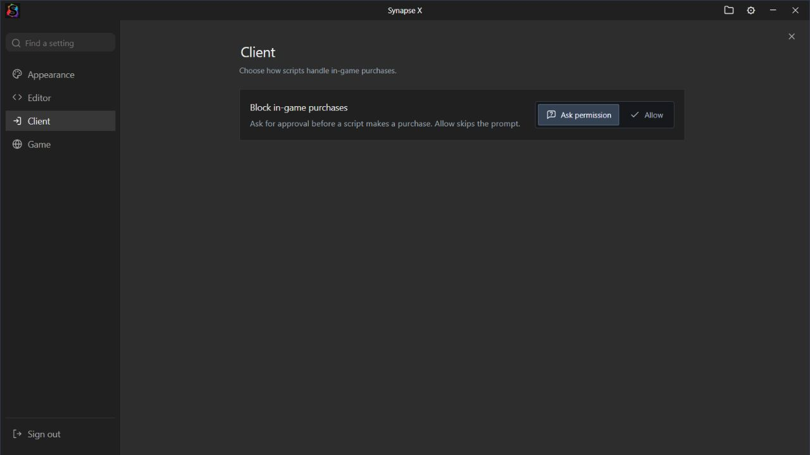
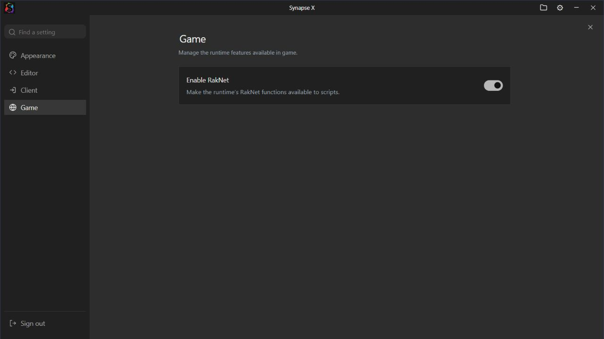

# Synapse X Executor

An unofficial Synapse X inspired interface for the supplied Windows application.
This project is not affiliated with the original Synapse X developers.

**[Download Synapse X Executor v1.3.8](https://github.com/j4522419-code/synapse-x-executor/releases/tag/v1.3.8)**

This candidate addresses a possible filename regression in v1.3.4. Live attachment
on the affected PC is still required to confirm whether it resolves the error.

The preview shows the actual Settings component in the browser test harness.

## Version 1.3.8 — purchase confirmation visibility

The inspected runtime's purchase confirmation requested foreground focus but
did not request an always-on-top window. This update adds `MB_TOPMOST` to that
specific dialog. Its existing text, OK/Cancel choices and purchase continuation
checks are unchanged. Cancel or a failed dialog does not enter the OK path.
The setting's **Allow** mode is unchanged.

Only the dialog flag and PE checksum differ from the previous 2.5.4 branded
DLL. The protected loader and application interface are unchanged. The launcher
can migrate the previous branded DLL through a matching verified catalog rule;
explicit source migrations are checked before old already-branded recognition.

Isolated emulation verified the prompt text, flags, enabled/disabled setting
and OK/Cancel/error branches. A first-party Windows dialog fixture verified
the actual TopMost style and Cancel return. A real game purchase event and live
attachment remain untested. This is a compatibility prerelease.

After fresh extraction, fully restart Roblox before attaching so it can load
the updated DLL. The existing private archive password is unchanged.

## Version 1.3.7 — Synapse X Executor

- Rename the repository to `synapse-x-executor` and update the launcher catalog URL.
- Use **Synapse X Executor** for interface labels, the window title, executable
  filenames, Windows product metadata, taskbar display name and new download.
- Preserve migration for pins to exact known earlier Synapse X executables.
- Keep the existing private extraction password; it is not in public documents
  or the executable. Publish only the executor archive as an uploaded asset.
- Retain one hidden runtime folder and the original vendor filenames/bytes.
  Native runtime identification remains unchanged for compatibility.

This remains a compatibility prerelease. The reported injection error is not
confirmed fixed and live attachment has not been run.

## Version 1.3.6 — one runtime folder and encrypted download

- Remove the redundant root `bin` and the mirror/seed copies. The package and
  launcher now use only `app/core/bin`; updates do not recreate another folder.
- Mark that folder Hidden in the archive and refresh its Hidden attribute at
  startup and after runtime preparation. Users can reveal hidden files; this
  does not restrict access or change Windows permissions or Explorer settings.
- Distribute a password-protected `.7z` archive with AES-256 encryption and
  encrypted filenames. Extract with 7-Zip; obtain the password privately from the distributor.
- Keep the exact v1.3.5 DLL/loader bytes and original native filenames. Those
  internal vendor names are retained for compatibility; do not rename them.
- Keep runtime identity **SYNAPSE X MADE BY GRAND / 1.3.4-grand**.

Extract into a **fresh folder**. Old copies are not deleted automatically, so
extracting over an earlier version can leave its old root `bin` behind.

The reported injection error `2147549194` is still not confirmed fixed. This
release retains v1.3.5's original runtime filenames and does not introduce
further runtime patches. Live attachment on the affected PC remains untested.

## Retained interface features

- Fix the **Ask permission / Allow** controls with a correctly sized container,
  consistent button height, contained selection borders and keyboard focus
  outlines. At narrow widths the controls move below the description.
- Add **Game** to Settings with the existing **Enable RakNet** switch. Its saved
  value is preserved; changing it uses the existing runtime setting.
- Give the native window an explicit taskbar identity and a relaunch command
  pointing to the main launcher. Taskbar launches include runtime preparation
  and the always-on-top error host automatically.
- Migrate pinned shortcuts targeting this installation or an exact known older
  themed executable. Preserve the original shortcut as a backup and leave
  unrelated pins alone. Launch the new root executable once after upgrading to
  migrate old pins. The compatibility entry at `app/Synapse X Executor.exe` also redirects
  automatically to the root launcher.
- Include verified catalog rules for both inspected vendor runtime versions,
  retaining the earlier rules for existing installations. Identity remains
  **SYNAPSE X MADE BY GRAND**; the retained rules report **1.3.4-grand**.

The permission controls were checked at normal and narrow window widths, in
both selection states and using the keyboard. RakNet persistence was checked
after reload. Native taskbar properties, shortcut migration and inner-to-root
startup were tested with first-party fixtures, without launching the supplied
core. The supplied runtime and live Roblox attachment remain untested.

## Other features

- Attach pulses green with a subtle outward ring after the client connection is
  confirmed. Disconnecting clears it. Reduced motion uses static green feedback.
- Attach failures show the reason returned by the runtime in a small Windows
  window that stays above other apps. Retry dismisses the previous error.
- Simplified home page: **Using Grand’s Internal**, Start actions, Tip of the Day
  underneath, and a large Synapse X Executor logo on the right. Recent Scripts and Getting
  Started are removed.
- Wider Scripts / Auto Execute pane with wrapped filenames and section labels.
  Its header arrow slides it closed; the folder button beside Settings reopens
  it. Ctrl+B also toggles the pane. Hidden contents cannot take keyboard focus.

## Install

1. Download `Synapse-X-Executor-v1.3.8-windows-x64.7z` from the release’s **Assets**.
2. Use [7-Zip](https://www.7-zip.org/) to extract the complete archive into a **fresh folder**, using the password shared privately by the distributor.
3. Restart Roblox to unload an older runtime.
4. Open the **top-level Synapse X Executor.exe**, keeping the complete `app` folder beside it.

The root executable launches the interface inside `app/core`, prepares compatibility
updates, and hosts the Windows error window. Windows x64 with .NET Framework 4.x
is required. Accept its normal Windows UAC prompt; the child interface inherits
the elevated context. Launch the root executable once after upgrading so known
old taskbar pins are migrated. Later taskbar launches start it automatically.
The compatibility entry in `app` redirects to it; keep the full directory layout.

The original vendor downloader checks for executor compatibility updates at
startup. The launcher then reads [runtime/catalog.json](runtime/catalog.json)
over HTTPS from this repository, falling back to its embedded catalog if the
remote catalog cannot be read. Only a matching, verified runtime is initialized.
The pre-branding copy is saved as `app/core/bin/Potassium.dll.before-branding`.

New catalog entries can support future vendor runtimes without replacing the
custom interface. An unknown runtime waits for a matching entry; retry after it
is published. The vendor GUI updater stays disabled so it cannot replace this
theme. Existing native sign-in requirements still apply.

## Editor and appearance

The classic charcoal interface retains the gray editor, compact tabs, colored
Lua/Luau syntax, diagnostics and bottom action row:
**Execute · Clear · Open File · Execute File · Save File · Attach**.

Execute turns green and fades back over 0.7 seconds as activation feedback. Clear
uses the editor’s undo boundaries. Open File imports a local script into a new tab;
Execute File sends the selected file through the existing execution request.
New tabs begin with `print("Grand was here");`; existing/imported contents remain intact.

- Ctrl+T / Ctrl+N: new tab. Ctrl+W: close active tab.
- Ctrl+Tab / Ctrl+Shift+Tab: next / previous tab, wrapping at either end.
- Ctrl+S: save. Ctrl+Enter: execute.
- Ctrl+B: show/hide scripts. Ctrl+backtick: toggle console.

Synapse X Executor is the only theme. The assistant and Agent Access entry points remain
removed. The native window caption, product metadata and application icon retain
Synapse X Executor branding. This edition keeps its own frontend preferences and tabs.

## Source and verification

Current packaging checks verify rejection of an incorrect password for listing
and extraction, a correct-password extraction of all 12 files, preserved Hidden
attributes, exactly one runtime folder and byte-for-byte matches to the package.
Startup fixtures verify the one-folder layout and original working directory.
Updater checks verify no duplicate root bin is recreated. See
[archive checks](docs/archive-verification.json) and
[layout checks](docs/runtime-layout-verification.json).

The password-protected release `.7z` is the runnable package. GitHub’s source-code ZIP contains the
documentation, theme assets and [launcher source](launcher/AttachErrorHost.cs),
not the full recovered native application source. The executor archive is the
only uploaded asset on the v1.3.8 release.

Tests cover Attach error extraction and propagation, native structured errors,
the existing channel-repair path, confirmation timeouts, disconnect feedback,
editor controls, keyboard shortcuts, diagnostics and progress presentation.
The first-party error host was run in its test mode: its actual Windows TopMost
style, Unicode reason text, update/dismiss behavior, origin checks and session
token checks passed. A browser integration test delivered the error to that
native window. The browser preview also verified wrapping, collapse/reopen and
the connected button’s animation styles.

Package checks verify embedded frontend assets, PE resources, checksums,
relocations, the administrator manifest and the embedded runtime catalog. Native
authentication and execution wrappers are preserved. The bundled runtime keeps
the existing internal-menu patch and changes its shared identification function
and default HTTP User-Agent value. The native GUI retains the original vendor runtime filenames in its
download and launch references. The [identity patch source](theme/runtime-identity.py)
is included for review. All other runtime bytes match the inspected source,
apart from the documented menu patch, purchase-dialog TopMost flag and PE checksum. The protected helper
executable and original internal filenames remain unchanged.

Isolated CPU emulation checks both Lua string returns, the HTTP User-Agent's
actual string allocation/cleanup, stack integrity and saved registers. Updater
tests use disposable runtime copies to check offline preparation, backups,
already-patched detection, simulated future catalog entries and rejection of
unknown files, invalid patches and incorrect output digests. Startup tests check
download → branding verification → native initialization and error handling.
The local bridge tests check authentication, session renewal and test-mode
refusal to install a runtime.

**The supplied native core, elevated application launch, live Roblox attachment
and a fresh live sUNC test have not been run.**

The theme keeps existing backend service/documentation URLs for compatibility.
See [NOTICE.txt](NOTICE.txt), [theme assets](theme/), and [launcher build notes](launcher/README.md).

## Roblox interference warning

This release does not bypass Roblox anti-cheat checks or claim to resolve its
third-party-software warning. If it appears before attaching, restart Windows
and test official Roblox while the executor remains closed. If it persists,
follow [Roblox's official anti-cheat troubleshooting](https://en.help.roblox.com/hc/en-us/articles/24275616578708-Anti-cheat-Messages)
and identify the conflicting software. No Roblox files, security settings or
running user applications were changed by this update's verification.
