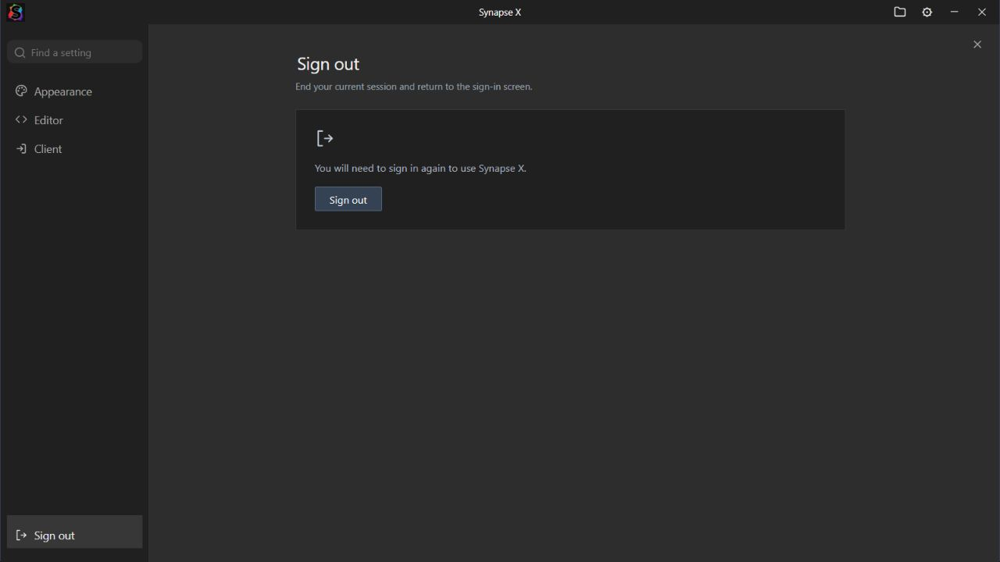

# Synapse X — themed edition

An unofficial Synapse X inspired interface for the supplied Windows application.
This project is not affiliated with the original Synapse X developers.

**[Download the Windows build](https://github.com/j4522419-code/synapse-x-potassium-theme/releases/latest)**

The preview shows the actual Settings component in the browser test harness.

## Version 1.3.2

- Rebuild Settings with only **Appearance**, **Editor**, **Client** and **Sign out** pages.
- Rewrite every visible setting description. Remove the theme selector and keep
  Synapse X as the fixed theme.
- Keep Streamer Mode and Tooltips in Appearance. Editor contains only Insert
  Spaces, Word Wrap, Minimap, Line Numbers, Bracket Colors, Smooth Cursor and
  Smooth Scrolling. All seven start enabled, including once when upgrading;
  later changes are saved normally.
- Remove all other visible controls. Hidden folding, autocomplete, diagnostics
  and multi-instance defaults remain enabled. The Console settings page and
  scrollback control are removed; output, timestamps, output/error redirection
  and clear-on-teleport stay enabled, while the saved scrollback limit is kept.
- Replace the purchase prompt’s hand icon with a question-message icon and an
  explicit **Ask permission** label. Keep the existing purchase-permission behavior.
- Replace Account with a dedicated **Sign out** page. Its visible Sign out button
  invokes the original native logout flow and returns to sign-in after success.
- The top-level launcher now requests administrator privileges through Windows
  UAC using an embedded `requireAdministrator` manifest.

The main Start tab remains separate from editable script tabs. New Script, the
plus button and Ctrl+T still create script tabs. The runtime reports **Synapse X**
and **1.3.2-grand** through `identifyexecutor()` / `getexecutorname()`.

Settings checks cover the visible allowlist, enabled defaults, preference
migration and persistence, retained hidden values and scrollback, purchase
selection, search, and the unchanged native sign-out route. Browser checks cover
the rendered pages, all seven switches, persistence after reload, and keyboard
selection of purchase permissions. Package checks read the actual embedded
administrator manifest without launching an elevated process.

## Other features

- Attach pulses green with a subtle outward ring after the client connection is
  confirmed. Disconnecting clears it. Reduced motion uses static green feedback.
- Attach failures show the reason returned by the runtime in a small Windows
  window that stays above other apps. Retry dismisses the previous error.
- Simplified home page: **Using Grand’s Internal**, Start actions, Tip of the Day
  underneath, and a large Synapse X logo on the right. Recent Scripts and Getting
  Started are removed.
- Wider Scripts / Auto Execute pane with wrapped filenames and section labels.
  Its header arrow slides it closed; the folder button beside Settings reopens
  it. Ctrl+B also toggles the pane. Hidden contents cannot take keyboard focus.

## Install

1. Download `Synapse-X-v1.3.2-windows-x64.zip` from the release’s **Assets**.
2. Extract the **complete ZIP** into a new folder, including the entire `app` folder.
3. Restart Roblox to unload an older runtime.
4. Open the **top-level Synapse X.exe**, keeping the `app` folder beside it.

The root executable is a small launcher and Windows error-window host. It starts
the main interface inside `app`. Windows x64 with .NET Framework 4.x is required.
Accept the normal Windows UAC prompt when opening the root launcher. Its child
interface runs in the same elevated context. Opening the inner executable
directly uses an in-app error dialog when the host
is unavailable; that fallback does not stay above other Windows apps.

This version bundles its inspected runtime in `app/bin`. Automatic vendor runtime
downloads are skipped to preserve the existing internal-menu removal. Update the
complete application from this repository’s releases; future Roblox changes may
require a compatible release. Existing sign-in requirements still apply.

## Editor and appearance

The classic charcoal interface retains the gray editor, compact tabs, colored
Lua/Luau syntax, diagnostics and bottom action row:
**Execute · Clear · Open File · Execute File · Save File · Attach**.

Execute turns green and fades back over 0.7 seconds as activation feedback. Clear
uses the editor’s undo boundaries. Open File imports a local script into a new tab;
Execute File sends the selected file through the existing execution request.
New tabs begin with `print("Grand was here");`; existing/imported contents remain intact.

- Ctrl+T / Ctrl+N: new tab. Ctrl+W: close active tab.
- Ctrl+Tab / Ctrl+Shift+Tab: next / previous tab, wrapping at either end.
- Ctrl+S: save. Ctrl+Enter: execute.
- Ctrl+B: show/hide scripts. Ctrl+backtick: toggle console.

Synapse X is the only theme. The assistant and Agent Access entry points remain
removed. The native window caption, product metadata and application icon retain
Synapse X branding. This edition keeps its own frontend preferences and tabs.

## Source and verification

The release ZIP is the runnable package. GitHub’s source-code ZIP contains the
documentation, theme assets and [launcher source](launcher/AttachErrorHost.cs),
not the full recovered native application source. Check the download against
`SHA256SUMS.txt` on the same release.

Tests cover Attach error extraction and propagation, native structured errors,
the existing channel-repair path, confirmation timeouts, disconnect feedback,
editor controls, keyboard shortcuts, diagnostics and progress presentation.
The first-party error host was run in its test mode: its actual Windows TopMost
style, Unicode reason text, update/dismiss behavior, origin checks and session
token checks passed. A browser integration test delivered the error to that
native window. The browser preview also verified wrapping, collapse/reopen and
the connected button’s animation styles.

Package checks verify embedded frontend assets, PE resources, checksums and
relocations. The supplied core code sections retain the previous release’s
branding-only edits; native authentication and execution wrappers are preserved.
The bundled runtime’s internal-menu patch is unchanged from v1.2.3; v1.3.2 also
updates its shared identification function. The [identity patch source](theme/runtime-identity.py)
is included for review. All other runtime bytes match the inspected source, apart
from the previously documented menu patch and the PE checksum.
**The supplied native core, elevated application launch and a live Roblox attachment have not been run.**

The theme keeps existing backend service/documentation URLs for compatibility.
See [NOTICE.txt](NOTICE.txt), [theme assets](theme/), and [launcher build notes](launcher/README.md).
