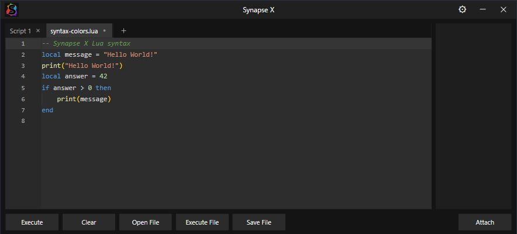
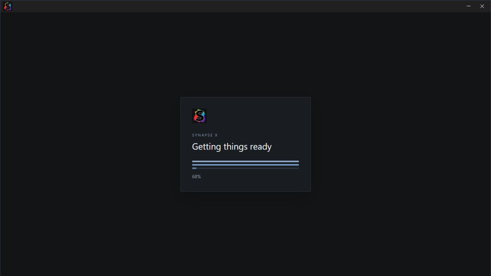

# Synapse X — themed edition

An unofficial Synapse X inspired interface for the supplied Windows application.
This project is not affiliated with the original Synapse X developers.

**[Download the Windows build](https://github.com/j4522419-code/synapse-x-potassium-theme/releases/latest)**

The preview shows the actual frontend components in a browser test harness.
The Windows executable and a live Roblox connection have not been tested.

## Version 1.2.1

- New startup and sign-in presentation with three filling bars. Startup displays
  native download percentages when available and animated bars while waiting.
- **Ctrl+T** creates a script tab; **Ctrl+W** closes the active one. Capture-phase
  handling prevents the editor from swallowing these shortcuts.
- Execute turns green on activation, then fades back to its normal color over
  0.7 seconds. Reduced motion uses brief static green feedback. The script action
  is still invoked once; the color indicates activation rather than execution success.
- Rebrand the native product name constructed from machine-code constants, plus
  package identifiers, Windows resources and remaining native display messages.
- Synapse X remains the only theme, with colored Lua/Luau syntax and existing
  diagnostics. Attach retains confirmed green / failed red feedback.

The startup preview uses a simulated 68% native-progress value; the actual
application uses its existing progress events and authentication flow.

## Install

1. Download `Synapse-X-v1.2.1-windows-x64.zip` from the latest release's **Assets**.
2. Extract every file into a new folder.
3. Open **Synapse X.exe**, keeping the three Microsoft runtime DLLs beside it.

Existing sign-in requirements still apply. No authentication or native execution
implementation is replaced by this theme.

## Theme

- Centered **Synapse X** title, matching executable/process name and Windows metadata.
- Dark-background logo in the application icon and top-left title bar.
- Charcoal window, plain gray editor, compact tabs and a right-hand scripts pane.
- Bottom controls: **Execute · Clear · Open File · Execute File · Save File · Attach**.
- Gear button for Settings, with separate preferences and tabs for this edition.
- No cosmic background, alternate-name chooser or extra launcher.

**Execute** uses the existing active-script action. **Clear** empties the editor
with its normal undo boundaries. **Open File** loads a local script into a new
tab, while **Execute File** sends the selected file through the existing execution
request. **Save File** saves to the application's scripts workspace. **Attach**
retains the native attachment flow and its error handling.

Shortcuts: Ctrl+T or Ctrl+N creates a tab, Ctrl+W closes the active tab, Ctrl+S
saves, Ctrl+Enter executes, Ctrl+B toggles the scripts pane, and Ctrl+backtick
toggles the console.

## Files and verification

The release ZIP is the runnable package. GitHub's source-code ZIP contains these
docs and customization assets, not the full native application source.
Compare the downloaded package's SHA-256 with `SHA256SUMS.txt` on the same release.

The theme stylesheet, feedback effects and icon are available in [theme/](theme/). Visible branding
and frontend storage identifiers use Synapse X naming; existing backend service
and documentation URLs remain compatible. The vendor GUI update check is disabled
so it cannot overwrite this customized interface.

Checks cover local file import, clear/edit routing and undo boundaries, toolbar
control states, branding, embedded assets, PE resources, checksum and relocations.
Native code sections match the baseline except for the explicitly verified
product-name data operands. Native authentication/session transitions and command
wrappers are preserved. Live Windows Alt+Tab behavior and Roblox attachment have
not been verified.

See [NOTICE.txt](NOTICE.txt) and [logo edit details](theme/logo-prompt.txt).
