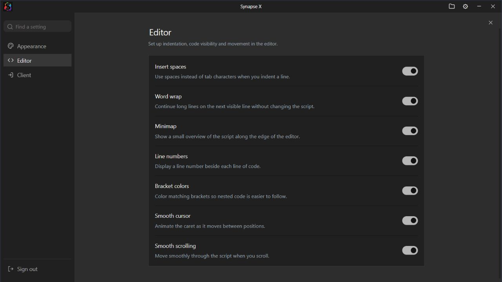

# Synapse X — themed edition

An unofficial Synapse X inspired interface for the supplied Windows application.
This project is not affiliated with the original Synapse X developers.

**[Download the Windows build](https://github.com/j4522419-code/synapse-x-potassium-theme/releases/latest)**

The preview shows the actual Settings component in the browser test harness.

## Version 1.3.3

- Both `identifyexecutor()` and `getexecutorname()` report
  **SYNAPSE X MADE BY GRAND**, version **1.3.3-grand**.
- The default HTTP User-Agent now also reports
  **SYNAPSE X MADE BY GRAND/1.3.3-grand**. Earlier builds changed the Lua
  identification functions but retained a separate native HTTP identity value.
- Restore the original vendor compatibility downloader at startup. Before native
  initialization, the launcher verifies the downloaded runtime and applies a
  matching branding/menu patch from this repository's runtime catalog.
- Check for new matching catalog entries automatically, with a bundled catalog
  for offline use. Validate source bytes and complete source/output SHA-256
  hashes, preserve a backup, and replace the prepared runtime atomically.
- An unfamiliar vendor runtime shows a clear error until a matching patch is
  published. Future vendor binaries require inspection and a matching catalog
  entry; this build cannot automatically adapt old offsets to unknown code.

Existing recorded test reports keep their stored labels. After installing into
a fresh folder, restart Roblox and run a **new** test to check the new label.
No test capabilities or scores were changed, and no fresh live sUNC report was
generated during verification.

The simplified Settings, enabled editor defaults, saved preferences, sign-out
flow, main Start tab, editor tabs, shortcuts and Attach feedback are retained.

## Other features

- Attach pulses green with a subtle outward ring after the client connection is
  confirmed. Disconnecting clears it. Reduced motion uses static green feedback.
- Attach failures show the reason returned by the runtime in a small Windows
  window that stays above other apps. Retry dismisses the previous error.
- Simplified home page: **Using Grand’s Internal**, Start actions, Tip of the Day
  underneath, and a large Synapse X logo on the right. Recent Scripts and Getting
  Started are removed.
- Wider Scripts / Auto Execute pane with wrapped filenames and section labels.
  Its header arrow slides it closed; the folder button beside Settings reopens
  it. Ctrl+B also toggles the pane. Hidden contents cannot take keyboard focus.

## Install

1. Download `Synapse-X-v1.3.3-windows-x64.zip` from the release’s **Assets**.
2. Extract the **complete ZIP** into a new folder, including the entire `app` folder.
3. Restart Roblox to unload an older runtime.
4. Open the **top-level Synapse X.exe**, keeping the `app` folder beside it.

The root executable launches the interface inside `app`, prepares compatibility
updates, and hosts the Windows error window. Windows x64 with .NET Framework 4.x
is required. Accept its normal Windows UAC prompt; the child interface inherits
the elevated context. **Launch the top-level executable**: the inner executable
cannot complete runtime preparation on its own.

The original vendor downloader checks for executor compatibility updates at
startup. The launcher then reads [runtime/catalog.json](runtime/catalog.json)
over HTTPS from this repository, falling back to its embedded catalog if the
remote catalog cannot be read. Only a matching, verified runtime is initialized.
The pre-branding copy is saved as `app/bin/Potassium.dll.before-branding`.

New catalog entries can support future vendor runtimes without replacing the
custom interface. An unknown runtime waits for a matching entry; retry after it
is published. The vendor GUI updater stays disabled so it cannot replace this
theme. Existing native sign-in requirements still apply.

## Editor and appearance

The classic charcoal interface retains the gray editor, compact tabs, colored
Lua/Luau syntax, diagnostics and bottom action row:
**Execute · Clear · Open File · Execute File · Save File · Attach**.

Execute turns green and fades back over 0.7 seconds as activation feedback. Clear
uses the editor’s undo boundaries. Open File imports a local script into a new tab;
Execute File sends the selected file through the existing execution request.
New tabs begin with `print("Grand was here");`; existing/imported contents remain intact.

- Ctrl+T / Ctrl+N: new tab. Ctrl+W: close active tab.
- Ctrl+Tab / Ctrl+Shift+Tab: next / previous tab, wrapping at either end.
- Ctrl+S: save. Ctrl+Enter: execute.
- Ctrl+B: show/hide scripts. Ctrl+backtick: toggle console.

Synapse X is the only theme. The assistant and Agent Access entry points remain
removed. The native window caption, product metadata and application icon retain
Synapse X branding. This edition keeps its own frontend preferences and tabs.

## Source and verification

The release ZIP is the runnable package. GitHub’s source-code ZIP contains the
documentation, theme assets and [launcher source](launcher/AttachErrorHost.cs),
not the full recovered native application source. Check the download against
`SHA256SUMS.txt` on the same release.

Tests cover Attach error extraction and propagation, native structured errors,
the existing channel-repair path, confirmation timeouts, disconnect feedback,
editor controls, keyboard shortcuts, diagnostics and progress presentation.
The first-party error host was run in its test mode: its actual Windows TopMost
style, Unicode reason text, update/dismiss behavior, origin checks and session
token checks passed. A browser integration test delivered the error to that
native window. The browser preview also verified wrapping, collapse/reopen and
the connected button’s animation styles.

Package checks verify embedded frontend assets, PE resources, checksums,
relocations, the administrator manifest and the embedded runtime catalog. Native
authentication and execution wrappers are preserved. The bundled runtime keeps
the existing internal-menu patch and changes its shared identification function
and default HTTP User-Agent value. The [identity patch source](theme/runtime-identity.py)
is included for review. All other runtime bytes match the inspected source,
apart from the documented menu patch and PE checksum.

Isolated CPU emulation checks both Lua string returns, the HTTP User-Agent's
actual string allocation/cleanup, stack integrity and saved registers. Updater
tests use disposable runtime copies to check offline preparation, backups,
already-patched detection, simulated future catalog entries and rejection of
unknown files, invalid patches and incorrect output digests. Startup tests check
download → branding verification → native initialization and error handling.
The local bridge tests check authentication, session renewal and test-mode
refusal to install a runtime.

**The supplied native core, elevated application launch, live Roblox attachment
and a fresh live sUNC test have not been run.**

The theme keeps existing backend service/documentation URLs for compatibility.
See [NOTICE.txt](NOTICE.txt), [theme assets](theme/), and [launcher build notes](launcher/README.md).
